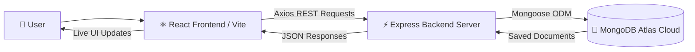

<div align="center">

# 💰 SpendWise

### Personal & Shared Expense Tracker

*Personal budgeting and group bill splitting, together in one clean platform.*

## 📖 Table of Contents

| # | Section | # | Section |
| :-: | :--- | :-: | :--- |
| 1 | [What It Does](#1-what-it-does) | 5 | [How It Works](#5-how-it-works) |
| 2 | [How It Is Different](#2-how-it-is-different) | 6 | [Getting Started](#6-getting-started) |
| 3 | [Tech Stack](#3-tech-stack) | 7 | [Future Improvements](#7-future-improvements) |
| 4 | [Features](#4-features) | 8 | [Author](#8-author) |

---

## 1. What It Does

**SpendWise** is an all-in-one expense management tool built to take the stress out of managing money. Track what you spend every day, and team up with roommates, friends, or travel partners to split bills fairly.

### 🎯 The Problem

Working out who paid for dinner, who owes rent, or digging through receipts in messy chat groups leads to confusion and awkward conversations.

### ✅ The Solution

SpendWise automates the math and keeps a permanent record.

| Need | How SpendWise Helps |
| :--- | :--- |
| 👤 **Personal spending** | Log daily purchases (food, travel, books), review monthly totals, and see a visual chart of where your money goes. |
| 👥 **Shared payments** | Create a room with a code, invite friends, add group bills, choose who took part, and get exact balances with simple repayment suggestions. |

---

## 2. How It Is Different

Most financial apps make you choose between a personal tracker and a bill-splitting app. SpendWise offers both side by side.

| | Highlight | Description |
| :-: | :--- | :--- |
| 🔄 | **Two Tools in One** | Manage private pocket expenses and shared flat or trip expenses from a single dashboard. |
| 🏠 | **Persistent Shared Rooms** | Create or join rooms with unique 6-character codes (e.g., `B78F1D`). Rooms are stored in MongoDB and reload automatically after a browser refresh. |
| 👥 | **Flexible Participants** | Pick the exact member who paid and select only the members who actually took part. |
| ➗ | **Automatic Equal Split** | The total is divided evenly among selected participants; non-participants are ignored. |
| ⚖️ | **Clear Balance Overview** | A live board shows who is in credit (**+₹**, owed money) and who is in debt (**-₹**, owes money). |
| 🤝 | **Direct Settlement Tracking** | Record a repayment in one click to keep room balances accurate. |

---

## 3. Tech Stack

SpendWise is built with modern, dependable open-source technologies.

### Core Technologies

| Technology | Layer | Role in SpendWise |
| :--- | :--- | :--- |
| 🍃 **MongoDB Atlas** | Database | Cloud database and single source of truth for personal expenses, rooms, room expenses, and settlements. |
| ⚡ **Express.js** | Backend framework | Handles API routes, request validation, and JSON responses. |
| ⚛️ **React 19** | Frontend library | Renders the UI, forms, live balance summaries, and view switching. |
| 🟢 **Node.js** | Runtime | Runs the backend API on your machine or server. |
| 🪝 **Mongoose** | ODM | Manages schemas, validation, and queries for MongoDB. |
| 📡 **Axios** | HTTP client | Sends async requests from React components to the Express backend. |
| ⚡ **Vite** | Build tool | Dev server with instant HMR, plus production builds. |
| 🎨 **Vanilla CSS** | Styling | Responsive, custom styling in a warm cream-and-brown palette. |

### Supporting Libraries

| Library | Purpose |
| :--- | :--- |
| **Chart.js** + **react-chartjs-2** | Doughnut spending charts |
| **CORS** | Cross-origin communication between client and server |
| **dotenv** | Environment variable management |

### 🎨 Color Palette

| Swatch | Hex | Usage |
| :-: | :--- | :--- |
| 🟫 | `#F3E9DC` | Cream (background) |
| 🟧 | `#C08552` | Tan (accent) |
| 🟤 | `#5E3023` | Brown (text and highlights) |

---

## 4. Features

### 💳 Personal Expense Management

| Feature | Description |
| :--- | :--- |
| **Add Expenses** | Log a title, amount (₹), and category: `Food`, `Transport`, `Education`, `Shopping`, `Entertainment`, or `Other`. |
| **Expense History** | View chronological transactions with dates and formatted amounts. |
| **Edit Expenses** | Update an existing expense's title, amount, or category. |
| **Delete Expenses** | Remove transactions, with a confirmation prompt. |
| **Category Chart** | Doughnut chart of spending percentages by category, alongside total and monthly metrics. |
| **Search & Filters** | Search by title, category, or amount; filter by `All`, `Today`, `This Week`, or `This Month`. |

### 🏠 Shared Room Management

| Feature | Description |
| :--- | :--- |
| **Create Rooms** | Choose a room name and your name; the backend generates a unique 6-character code. |
| **Join with Code** | Enter a room code and your member name to join. |
| **Persistent Dashboard** | On launch or refresh, all rooms you created or joined load from MongoDB as room cards. |
| **Room Details** | See the creator, join dates, and the full member roster. |
| **Quick-Copy Code** | Copy the room code to your clipboard with one click. |

### 🧾 Shared Expense Management

| Feature | Description |
| :--- | :--- |
| **Add Shared Expenses** | Record group spending with a title, amount, and category. |
| **Select the Payer** | Choose any room member as the person who paid. |
| **Choose Participants** | Check or uncheck members to split the cost only among those involved. |
| **Equal Share Calculation** | Automatically divides the bill by the number of participants. |
| **Edit & Delete** | Change amounts, payers, or participants, or delete a bill; balances recalculate live. |

### 🤝 Balance & Settlement Management

| Feature | Description |
| :--- | :--- |
| **Member Balance Summary** | Per-member breakdown of amount paid, fair share consumed, and net balance. |
| **Who Owes Whom** | **+₹** means a creditor who is owed money; **-₹** means a debtor who owes money. |
| **Suggested Payments** | A debt-resolution algorithm matches debtors with creditors to suggest the minimum payments needed. |
| **Record Settlements** | Log repayments between members (`From Member`, `To Member`, `Amount`). |
| **Settlement History** | Full log of settled payments, with the option to delete accidental records. |

> ⚠️ **Prototype Notes**
> - User authentication (login/passwords) is not yet implemented; room access is based on member names and room codes.
> - Editing transactions currently uses browser prompts.

---

## 5. How It Works

### 🏗️ Architecture



### 🔁 Request Flow

| Step | Stage | What Happens |
| :-: | :--- | :--- |
| 1 | **User Action** | You create a room, log an expense, or record a settlement in the browser. |
| 2 | **Frontend Service** | React calls an Axios service function in `client/src/services/`. |
| 3 | **Backend API** | Express (`server/server.js` and `server/routes/`) validates data and applies business logic. |
| 4 | **Database** | Mongoose saves or queries documents in MongoDB Atlas. |
| 5 | **Live Update** | Express returns JSON, and React instantly refreshes cards, charts, and balances. |

### 🍽️ Example: Splitting a ₹900 Dinner

**Scenario:** Alex and Sam share an apartment. Alex pays a ₹900 dinner bill, and both took part.

| Detail | Value |
| :--- | :--- |
| Total bill | ₹900 |
| Payer | Alex |
| Participants | Alex, Sam (2 people) |
| **Share per person** | **₹900 ÷ 2 = ₹450** |

**Resulting balances**

| Member | Paid | Consumed | Balance | Status |
| :--- | :-: | :-: | :-: | :--- |
| **Alex** | ₹900 | ₹450 | **+₹450** | Is owed ₹450 |
| **Sam** | ₹0 | ₹450 | **-₹450** | Owes ₹450 |

**Settlement**

1. **Suggested payment:** Sam pays Alex ₹450.
2. **Record it:** Sam hands over the money and logs it under *Record a Payment*.
3. **Result:** Both balances return to **₹0**, and the debt is settled. 🎉

---

## 6. Getting Started

Follow these steps to run SpendWise locally.

### 📋 Prerequisites

| Requirement | Notes |
| :--- | :--- |
| **Node.js** | v18 or higher, with npm |
| **Git** | For cloning the repository |
| **MongoDB** | A free MongoDB Atlas account, or a local MongoDB instance |

### Step 1 · Clone the Repository

```bash
git clone https://github.com/your-username/spendwise.git
cd spendwise
```

### Step 2 · Configure Environment Variables

Create a `.env` file inside `server/` from the example:

```bash
cd server
cp .env.example .env
```

Then add your MongoDB connection string:

```env
PORT=5000
MONGO_URI=mongodb+srv://<username>:<password>@<cluster>.mongodb.net/spendwise?retryWrites=true&w=majority
```

| Variable | Description | Example |
| :--- | :--- | :--- |
| `PORT` | Port the backend listens on | `5000` |
| `MONGO_URI` | MongoDB Atlas connection string | `mongodb+srv://...` |

### Step 3 · Install Dependencies

```bash
# Backend
cd server
npm install

# Frontend
cd ../client
npm install
```

### Step 4 · Run the Application

Open **two terminal windows**:

| Terminal | Commands | Runs On |
| :--- | :--- | :--- |
| **1 · Backend** | `cd server` → `npm run dev` | `http://localhost:5000` |
| **2 · Frontend** | `cd client` → `npm run dev` | `http://localhost:5173` |

### Step 5 · Open in Your Browser

Visit **<http://localhost:5173>**. SpendWise is ready to use! 🚀

---

## 7. Future Improvements

| Status | Planned Feature | Details |
| :-: | :--- | :--- |
| 🔐 | **User Accounts & Authentication** | Secure sign-up and login with JWT and encrypted passwords. |
| 📱 | **Modern Modal Dialogs** | Custom in-app dialogs to replace browser prompts for editing. |
| 📊 | **Unequal & Percentage Splits** | Custom split percentages or exact amounts. |
| 📄 | **Export Reports** | Download personal spending and room balance summaries as PDF or CSV. |
| 🧾 | **Receipt Attachments** | Upload bill receipts or photos to shared expenses. |
| 🌐 | **Dynamic API URL Config** | Read the backend URL from `import.meta.env.VITE_API_URL` for easier cloud deployment. |

---

## 8. Author

| | |
| :--- | :--- |
| **Developer** | [Your Name / GitHub Profile](https://github.com/annihilate24) |
| **Project** | Developed as a MERN Stack Capstone / Portfolio Project |
| **Feedback** | Contributions, issues, and feature requests are welcome! |

---

<div align="center">

*Made with ❤️ for simple, stress-free money management.*

</div>